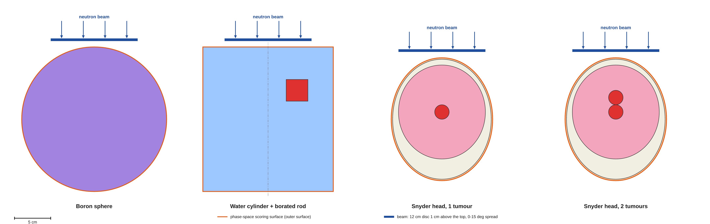
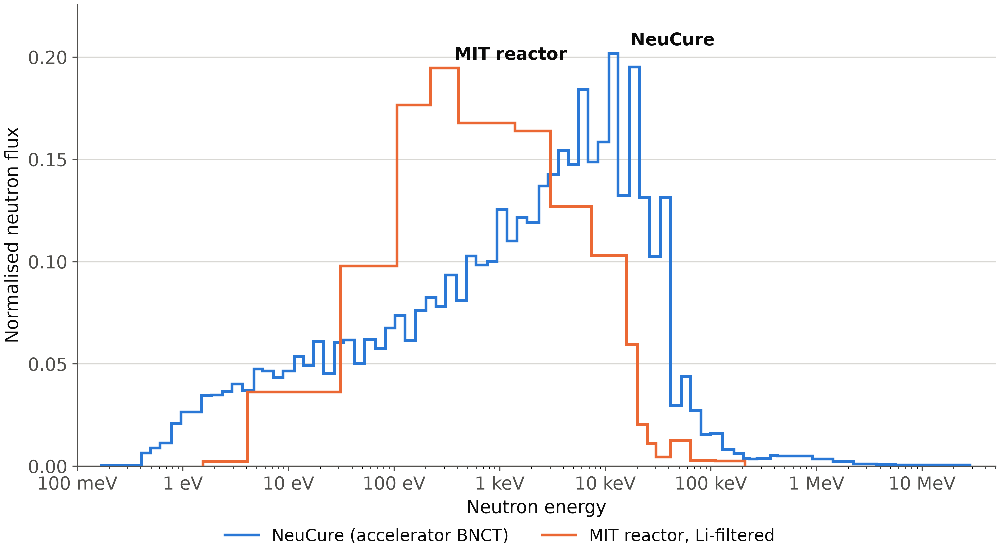

# BNCT phase-space framework (`phantoms_sim`)

A Geant4 application to separate the simulation of a BNCT irradiation from the simulation of a prompt-gamma detector, using the IAEA phase-space format.

1. **Write.** A neutron beam is transported through a phantom once. Every
   particle leaving the phantom surface (photons, neutrons, electrons,
   positrons, protons) is recorded into an IAEA phase-space file with its
   type, energy, position and direction. A 3D dose and gamma-origin mesh is
   scored in the same run.
2. **Read.** The file is used as the primary source of any later simulation:
   each event replays one original history at the phantom surface. Every
   detector configuration then sees the same irradiation, without repeating
   the beam and phantom transport.
3. **Trim.** While reading, records can be filtered by particle type, kinetic
   energy, direction and position, to test a detector under a defined
   sub-condition (for example only the 478 keV boron-capture photons).

The IAEA format is code-independent, so the phase-space files can also be read
outside Geant4 (see the IAEA library in `iaea_phsp/`).

## Contents

| Path | What it is |
|---|---|
| `phantoms_sim.cc`, `source/`, `include/` | The application: geometry, physics, beam source, phase-space writer and reader |
| `iaea_phsp/` | IAEA phase-space library (C/C++, IAEA, MIT-style licence in the source files) |
| `macros/` | Beam definitions, test macros for writing, reading and trimming, visualisation |
| `macros/final_runs/` | The production macros (8 phantom × beam combinations, 1e9 primaries each) and their runner script |
| `docs/GEOMETRY_AND_BEAMS.md` | World, phantoms, beams, scoring mesh: dimensions, materials, sources |

Phantoms (`/geometry/phantomType`): `0` boron sphere, `1` water cylinder with
a borated rod, `2`/`3` Snyder head with one/two tumours, `4` world only.
Beams: `NeuCure.mac` (accelerator BNCT) and `epithermalMIT.mac` (MIT reactor,
Li-filtered), both a 12 cm disc 1 cm above the phantom. Physics list:
QGSP_BIC_HP with radioactive decay. Dimensions, materials and sources are in
[docs/GEOMETRY_AND_BEAMS.md](docs/GEOMETRY_AND_BEAMS.md).





## Build

Requires Geant4 (tested with 11.3.0, multithreaded, with the neutron data
sets G4NDL) and CMake ≥ 3.16.

```bash
mkdir -p build phsp
cd build
cmake ..                     # or: cmake -DGeant4_DIR=/path/to/lib/cmake/Geant4 ..
cmake --build . --parallel
```

The executable and the macros end up in `build/`. Phase-space files are large
and are not part of the build: the macros read and write them in `phsp/`
(as `../phsp/...` from `build/`).

## Quick start

From `build/`:

```bash
./phantoms_sim test-writer.mac 16 12345   # write: 1e6 NeuCure neutrons into the cylinder
./phantoms_sim test-reader.mac 16 1       # read it back as the primary source
./phantoms_sim test-trim.mac   16 1       # read only 478 keV photons moving towards -x
```

`test-writer.mac` takes about 2 minutes on 16 threads and writes
`../phsp/test_physPhantom_to_physWorld.IAEAphsp` and `.IAEAheader`
(about 1.0 M records, 33 MB), plus the mesh files `doseDepMesh.csv`,
`gammasB.csv` and `gammasH.csv` in `build/`. The `.IAEAheader` is a text file
with the particle counts and energy ranges.

Command line: `./phantoms_sim [macro] [nThreads] [seed]` (multithreaded build;
default 25 threads, seed 123456789). With no macro the interactive session
opens with `vis.mac`. `./phantoms_sim --vis <macro> [nThreads] [seed]` runs a
macro and then keeps the visualisation session open.

## Using a phase space with your own detector

The reader is in `G4IAEAphspReader` and is enabled by one command before
`/run/initialize`:

```
/geometry/phantomType 4                     # no phantom: replace with your detector
/action/IAEAphspReader/fileName ../phsp/<name>_physPhantom_to_physWorld
/run/initialize
```

To use it in another application, take `G4IAEAphspReader`,
`G4IAEAphspReaderMessenger`, `IAEASourceIdRegistry` and the `iaea_phsp/`
library, and call `G4IAEAphspReader::GeneratePrimaryVertex()` from your
primary generator (as `PrimaryGeneratorAction` does here). The phase-space
coordinates are those of the writer's world: keep the phantom position in mind
when placing the detector, or use `/IAEAphspReader/translate` and
`/IAEAphspReader/rotateX|Y|Z`.

**Normalisation.** The header's `ORIG_HISTORIES` is the number of beam
neutrons simulated. With `trimCompactEvents false` (the default), one Geant4
event is one original history, so N events correspond to N beam neutrons
whatever the trimming.

## Trimming

All filters are applied per record, after reading and before the primary is
created; a record must pass every enabled filter. `trimEnable` is the master
switch.

```
/IAEAphspReader/trimEnable           true
/IAEAphspReader/trimTypeEnable       true
/IAEAphspReader/trimTypes            gamma            # gamma electron positron neutron proton, or 1-5; comma or space list
/IAEAphspReader/trimEnergyEnable     true
/IAEAphspReader/trimEnergyMin        468 keV          # kinetic energy, inclusive
/IAEAphspReader/trimEnergyMax        488 keV
/IAEAphspReader/trimDirectionEnable  true
/IAEAphspReader/trimDirectionMin     -1 -1 -1         # (u, v, w) direction cosines, inclusive box
/IAEAphspReader/trimDirectionMax      0  1  1
/IAEAphspReader/trimAreaEnable       true
/IAEAphspReader/trimAreaMin          -9 -9 -10 cm     # (x, y, z) position on the scoring surface
/IAEAphspReader/trimAreaMax           9  9  10 cm
/IAEAphspReader/trimCompactEvents    false            # true: skip histories with no accepted record
```

These commands are available after `/run/initialize`. See `test-trim.mac`.

Other reader commands (`/IAEAphspReader/...`): `verbose`, `numberOfParallelRuns`
and `parallelRun` (split a file between independent jobs), `recycling` (reuse
each record N extra times), `axialSymmetryX|Y|Z` (random rotation per reuse),
`translate`, `rotateX|Y|Z`, `rotationOrder`, `isocenterPosition`.

## Writing a phase space

```
/action/IAEAphspWriter/namePrefix      ../phsp/<name>
/action/IAEAphspWriter/scoringBoundary physPhantom->physWorld   # physHead->physWorld for the Snyder heads
/geometry/phantomType 1
/run/initialize
/control/execute NeuCure.mac
/run/beamOn <N>
```

Output: `<namePrefix>_<pre>_to_<post>.IAEAphsp` and `.IAEAheader`
(`/action/IAEAphspWriter/scoringVolume <post>` records first entries into a
volume instead, tagged `<namePrefix>_<post>`). A track is recorded the first
time it crosses the boundary in the registered direction (pre → post); a
particle that re-enters the phantom and leaves again is not recorded twice.
Supported types:
gamma, electron, positron, neutron, proton. Each record stores x, y, z (cm),
u, v, w, kinetic energy (MeV), weight, and the number of histories since the
previous record (`n_stat`), which keeps the history structure.

The production files were made with `macros/final_runs/` (one per phantom ×
beam, 1e9 primaries, with the dose mesh):

```bash
./macros/final_runs/run_final_productions.sh     # from the package root, after building
```

It runs the macros one after another, refuses to overwrite existing output,
checks for free disk space, and moves each run's files to
`phsp/final_runs/<macro name>/`. Override `THREADS`, `SEED` and `RUNS`
(space-separated macro names) through the environment.

## Known limitations (w.i.p.)

- **Multithreaded reading is not one-to-one.** Each worker thread reads its own equal slice of the file, but Geant4 hands events to threads dynamically. A thread that receives more events than its slice has histories will start its slice again; one that receives fewer leaves its last histories unread (in a test with 8 threads, 1689 primaries were generated where the file holds 1684 matching records). The replay is statistically equivalent; for an exact one-to-one replay use one thread, or split the file with  `numberOfParallelRuns` / `parallelRun` across single-threaded jobs.
- Records at the very end of the file can be left out when it is split between threads (for example 4 of 1,005,516 records with 8 threads).

## Origin and credits

This framework is based on the Geant4 advanced example **IAEAphsp** (`examples/advanced/IAEAphsp`, distributed with Geant4 from version 11.4), by M.A. Cortés-Giraldo, Universidad de Sevilla. The phase-space reader and writer classes and the IAEA library in `iaea_phsp/` come from that example; if you use this code, please also cite the example's reference paper (below).

New functionalities:

- phase-space scoring at volume boundaries instead of planes at constant z;
- record trimming by particle type, kinetic energy, direction and position;
- the BNCT phantoms, the neutron beams (GPS) and the scoring mesh;
- fixes to the multithreaded reader partition and to the `rotationOrder` command; removal of the linac collimator/gantry rotations.

A detail of the modifications is present on each file's header.

## References

- Phase-space reader and writer (the Geant4 IAEAphsp example): M.A.
  Cortés-Giraldo et al., Int J Radiat Biol 88(1-2): 200-208 (2012),
  doi:10.3109/09553002.2011.627977.
- IAEA phase-space format: R. Capote et al., IAEA(NDS)-0484 (2006),
  https://www-nds.iaea.org/phsp/
- Cylindrical phantom: doi:10.1016/j.apradiso.2011.01.030.
- Snyder head phantoms: doi:10.1016/j.apradiso.2017.03.014.
- NeuCure beam: doi:10.1016/j.nima.2024.170126.
- MIT reactor beam with Li filter: Mirzaei et al. 2014, doi:10.1007/s10967-014-3397-2.

## Licence

The code is distributed under the [Geant4 Software License](LICENSE)
(http://cern.ch/geant4/license). The IAEA phase-space routines in
`iaea_phsp/` keep the IAEA permission notice contained in their source files.
The phase-space data files are distributed separately under CC-BY 4.0 (see
the data record).

This product includes software developed by Members of the Geant4
Collaboration ( http://cern.ch/geant4 ).
