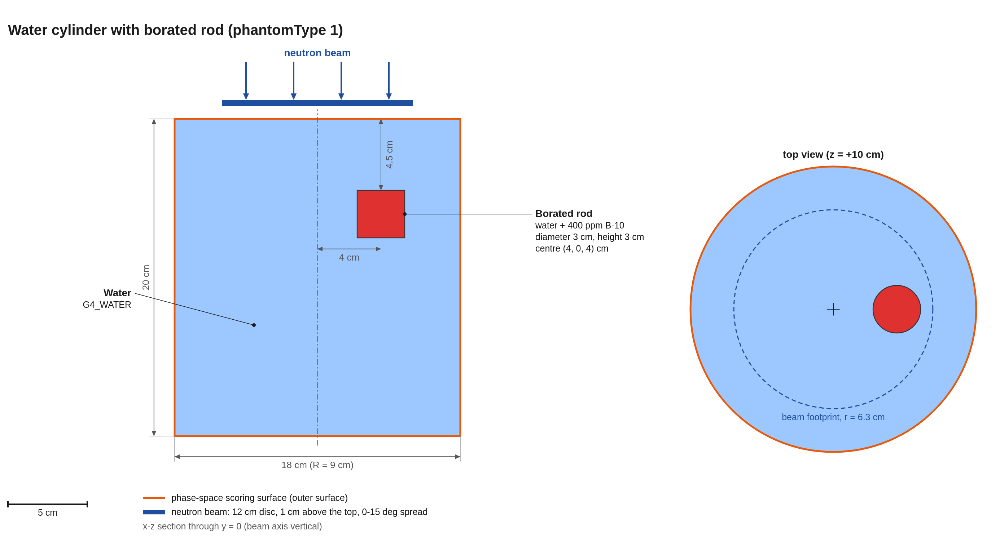
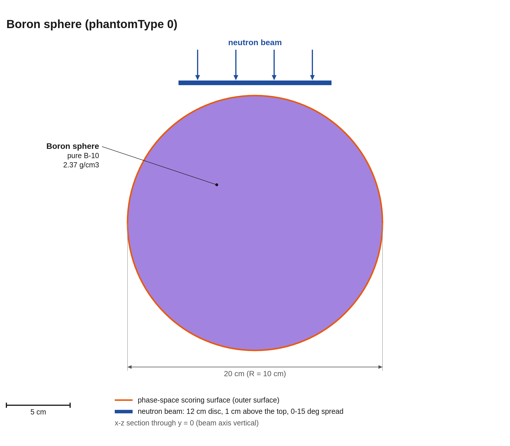
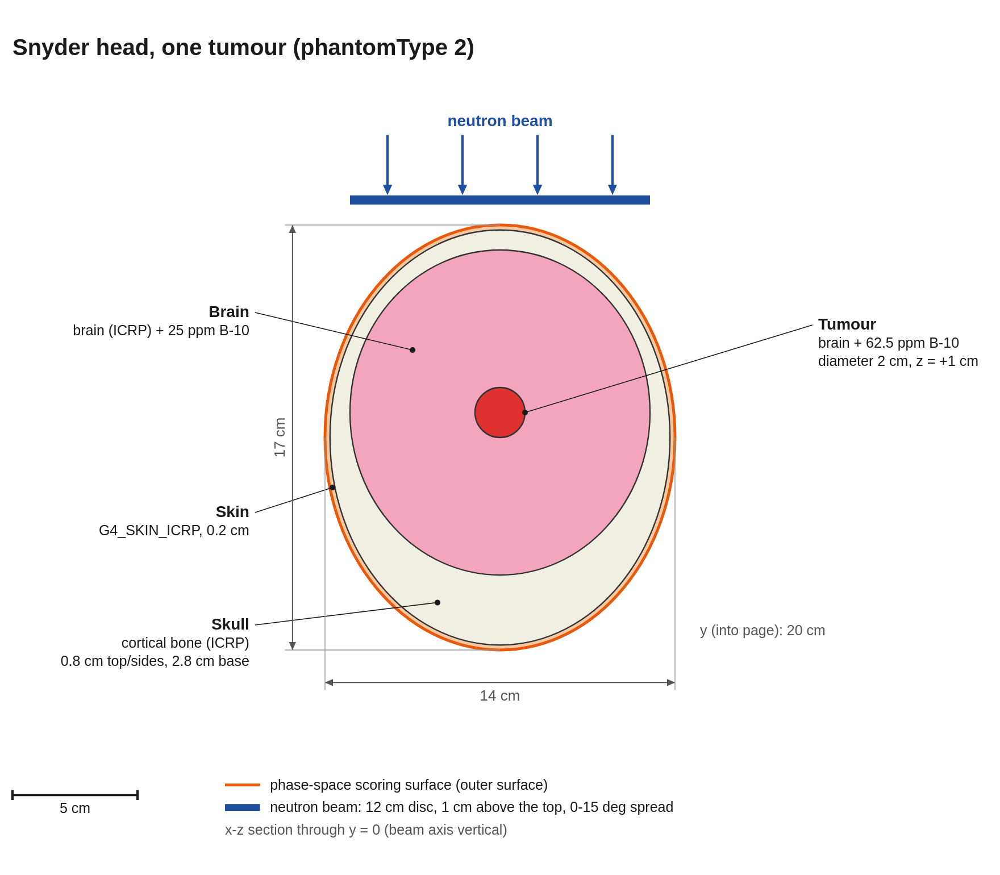
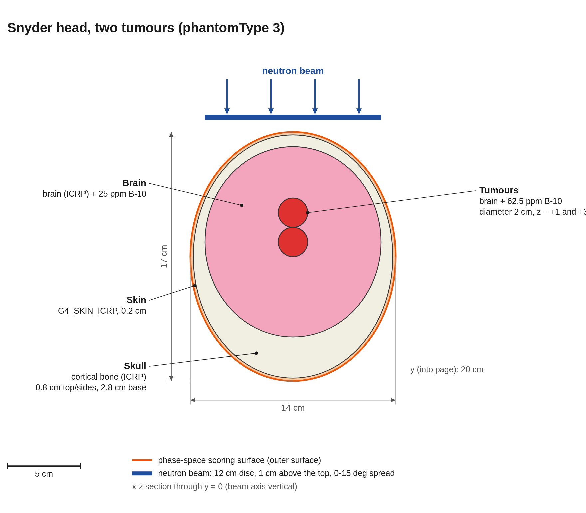

# Geometry and beams

Reference for the characteristics of the world, the phantom options, and the two neutron beams used to write the phase-space files.
Units are cm, with the beam entering from +z unless stated otherwise.

---

## 1. World and scoring

| Item | Value |
|---|---|
| World | `G4Box`, G4_AIR, half-size 50 cm (1 m cube), centred at the origin |
| Phantom | placed at the origin; for the cylinder the axis is z |
| Physics | QGSP_BIC_HP plus radioactive decay |
| Phase-space scoring | every particle crossing the phantom's outer volume into the world (`/action/IAEAphspWriter/scoringBoundary`), written as an IAEA phase space |
| Debug shell (optional) | `/geometry/enableDebugDetector true`: a vacuum spherical shell at r = 30–31 cm |

**The scoring boundary depends on the phantom.** The outer volume should be `physPhantom` for types 0 and 1 and `physHead` for types 2 and 3. [test-writer.mac](../macros/test-writer.mac) uses `physPhantom->physWorld`. 

Choose the phantom with `/geometry/phantomType N`, before `/run/initialize`. Type 4 builds the world only (no phantom).

---

## 2. Phantom options

The following phantoms are available (x-z sections through y = 0, all at the same scale, beam from the top):


### Type 1 — cylindrical phantom



| Part | Shape and size | Position | Material |
|---|---|---|---|
| Phantom (`physPhantom`) | `G4Tubs`, R = 9 cm, half-length 10 cm (20 cm tall) | centred at the origin, axis z | G4_WATER |
| Tumour rod (`physTarget`) | `G4Tubs`, R = 1.5 cm, half-length 1.5 cm (3 cm tall) | centre (4, 0, **+4**) cm, so it spans z = 2.5 to 5.5 cm | water + 400 ppm B-10 by mass, 1.0 g/cm³ |

- The rod sits on the beam side, 4.5 cm below the top surface. Its depth along the beam runs from 4.5 to 7.5 cm, and it lies fully inside the beam footprint
  (x from 2.5 to 5.5 cm, while the beam radius is 6 cm).
- The rod is **fully enclosed** in water, with 4.5 cm of water above it, 12.5 cm below it and 3.5 cm of water to the side.
- **Macro controls** (before `/run/initialize`):
  - `/geometry/rodHalfLength 1.5 cm`
  - `/geometry/rodPosZ 4 cm`
  - The radius and x offset are fixed in the constructor (`rod_radius`, `rod_posX`).
- The geometry is based on the cylindrical "Minsky" phantom, used by studies at the University of Birmingham (doi:10.1016/j.apradiso.2011.01.030, doi:10.3389/fphy.2024.1347929). The 400 ppm boron loading is a strong imaging target, well above clinical tumour levels.
- **Imaging:** the beam enters through the top cap.

### Type 0 — boron sphere



| Part | Shape | Position | Material |
|---|---|---|---|
| Phantom (`physPhantom`) | `G4Sphere`, R = 10 cm | origin | `boronMaterial` = **pure B-10 at 2.37 g/cm³** |

A solid sphere of pure B-10 absorbs essentially all thermal neutrons in its first millimetres, so it does not behave like a tissue phantom, it provides a big source of 478 keV gammas. 

### Types 2 and 3 — Snyder head (one or two tumours)

These are nested ellipsoids, based on doi:10.1016/j.apradiso.2017.03.014.
Values are semi-axes (x, y, z) in cm.

| One tumour (type 2) | Two tumours (type 3) |
|---|---|
|  |  |

| Part | Shape | Position (in its mother volume) | Material |
|---|---|---|---|
| Head / skin (`physHead`) | ellipsoid 7.0 × 10.0 × 8.5 | origin, in the world | G4_SKIN_ICRP |
| Skull (`physSkull`) | ellipsoid 6.8 × 9.8 × 8.3 minus a cavity of 6.0 × 9.0 × 6.5 offset +1 cm in z | origin, in the head | G4_BONE_CORTICAL_ICRP |
| Brain (`physBrain`) | ellipsoid 6.0 × 9.0 × 6.5 | (0, 0, +1), in the head, filling the skull cavity | G4_BRAIN_ICRP + 25 ppm B-10, 1.0 g/cm³ |
| Tumour, type 2 (`physTarget`) | sphere R = 1 cm | (0, 0, 0) in the brain, so z = +1 in global coordinates | G4_BRAIN_ICRP + 62.5 ppm B-10 |
| Tumours, type 3 (`physTarget1`, `physTarget2`) | two spheres, R = 1 cm | (0, 0, 0) and (0, 0, 2) in the brain, so z = +1 and +3 globally | as above |

- **Skin and skull thickness:** skin is 0.2 cm all round. Because the brain is
  shifted up, the skull is 0.8 cm thick at the top and sides and 2.8 cm at the
  base.
- **Boron loading:** tumour-to-brain ratio of 62.5 / 25.

---

## 3. Beams

Both beam macros use the **same geometry**. Each beam is set with `/control/execute <macro>` after `/run/initialize`. Inside the macros themselves, the sources are defined via General Particle Source (/gps/...) commands.

### Common geometry

| Property | Value | Command |
|---|---|---|
| Particle | neutron | `/gps/particle neutron` |
| Shape | flat disc, **uniform per unit area** | `/gps/pos/type Plane`, `/gps/pos/shape Circle` |
| Diameter | **12 cm** (radius 6 cm), from the clinical aperture range of 12–14 cm | `/gps/pos/radius 6. cm` |
| Position | centre (0, 0, **11**) cm: 1 cm above the top cap of the cylinder (and of the sphere) | `/gps/pos/centre 0. 0. 11. cm` |
| Direction | along −z, into the top cap. This is the GPS default for a Plane source with no rotation. | — |
| Angular spread | cosine law, θ = 0–15° from the axis, φ = 0–360° | `/gps/ang/type cos`, `mintheta 0`, `maxtheta 15 deg` |


### Energy spectra

| | NeuCure (accelerator BNCT) | MIT reactor, Li-filtered epithermal beam |
|---|---|---|
| Macro | `NeuCure.mac` | `epithermalMIT.mac` |
| Source of the spectrum | doi:10.1016/j.nima.2024.170126, figure "Normalised neutron flux (%)", NeuCure curve | Mirzaei et al. 2014, doi:10.1007/s10967-014-3397-2, figure "Flux (cm⁻² s⁻¹)", "With Li" curve |


Data was manually digitised from the sources.

---

## 4. Writing a phase space

Minimal order of commands. [test-writer.mac](../macros/test-writer.mac)
follows it, and adds the scoring mesh (section 5).

```
/action/IAEAphspWriter/namePrefix  ../phsp/<name>
/action/IAEAphspWriter/scoringBoundary physPhantom->physWorld   # physHead->physWorld for types 2/3
/geometry/phantomType 1
# /geometry/rodPosZ 4 cm          # defaults; only needed to change them
# /geometry/rodHalfLength 1.5 cm
/run/initialize
/run/setCut 1 mm
/control/execute NeuCure.mac       # or epithermalMIT.mac
/run/beamOn <N>
```

The output is `<name>_physPhantom_to_physWorld.IAEAphsp` and `.IAEAheader`.

| Phantom | Type | Scoring surface | Beam disc z | Outer surface |
|---|---|---|---|---|
| cylinder | 1 | `physPhantom` | 11 cm | R 9 cm, half-length 10 cm |
| sphere | 0 | `physPhantom` | 11 cm | R 10 cm |
| Snyder head, one tumour | 2 | `physHead` | 9.5 cm | skin ellipsoid 7 × 10 × 8.5 cm |
| Snyder head, two tumours | 3 | `physHead` | 9.5 cm | same |

[production-writer.mac](../macros/production-writer.mac) takes these settings as aliases, for splitting a large production into independent chunks (one job per chunk, each with its own seed). [test-geometry.mac](../macros/test-geometry.mac) takes the same aliases and checks overlaps, the beam start points and the scoring boundary.

---

## 5. Scoring mesh

The writer macros also score a 3D box mesh in parallel with the phase space (`/score/...` commands, dumped to CSV at the end of the run):

| Quantity | File | Filter |
|---|---|---|
| Dose deposited by alpha particles | `doseDepMesh.csv` | particle = alpha |
| Number of 478 keV photons created (boron capture) | `gammasB.csv` | gamma, 477–479 keV |
| Number of 2.223 MeV photons created (hydrogen capture) | `gammasH.csv` | gamma, 2220–2230 keV |

The mesh has half-sizes 9 × 10 × 9 cm and 45 × 50 × 45 bins (0.4 cm voxels), centred at the origin.
